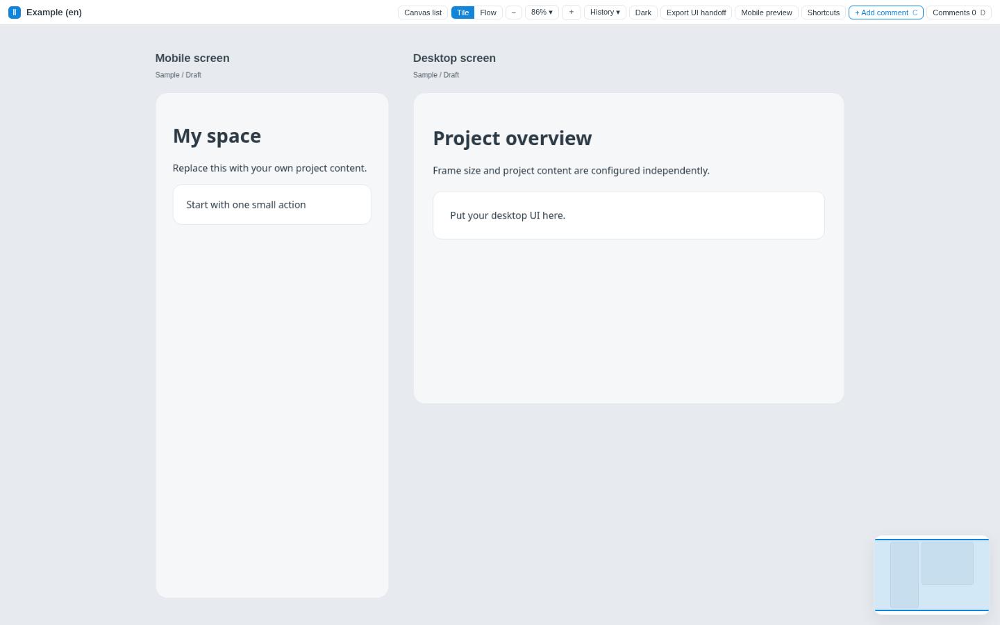
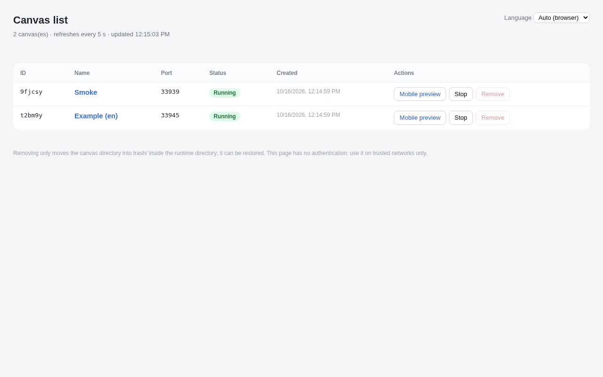

# Easy UI Canvas

English | [简体中文](README.zh-CN.md)

A small local web canvas for **exploring UI designs**: put several HTML screens (frames) side by side on a zoomable, pannable board, comment on individual elements, click through flows on a phone, and let an AI coding agent read and answer the comments in the next session. It runs on your machine, needs only the Python 3 standard library, and works as an agent skill (Claude Code, Cursor, Codex) or as a plain command-line tool.





## Features

- **Multi-frame canvas**: tile view with zoom, pan, minimap and fit-to-window; frames are plain HTML/CSS fragments you or an agent write.
- **Element comments**: click any element (or the whole frame), write feedback, track it as pending / changed / needs discussion, copy it for an AI, and reply from the command line.
- **Flow view and phone preview**: mark buttons with `data-goto` to make a prototype clickable inside the canvas and at `/m/` on a phone (QR code included).
- **Snapshots**: keep earlier revisions with their comments and look back at them read-only.
- **Many canvases, one list page**: each canvas is its own small server; a list page starts, stops and removes them.
- **UI hand-off export**: one ZIP with offline pages, screenshots, assets and a `HANDOFF.md` (needs optional tools, see below).
- **English and Chinese UI**, switchable on the list page; also for server errors and CLI output.
- **No build step, no CDN, no third-party Python packages.**

## Quick start

Requirements: Python 3.9 or newer, macOS or Linux (Windows through WSL).

```bash
git clone <repo-url> easy-ui-canvas
cd easy-ui-canvas
python3 scripts/canvas.py ensure-list                 # starts the list service on http://127.0.0.1:4042/
python3 scripts/canvas.py new --name "My first canvas" # creates a canvas from the example and starts it
```

Open the `url` printed by `new` (or pick the canvas on the list page). Replace the example frames in the canvas directory (`frames/*.html`, `project.json`; the directory is printed as `dir`) with your own design and refresh the page. See [docs/project-format.md](docs/project-format.md) for the format.

Everyday commands:

```bash
python3 scripts/canvas.py list                          # canvases, ports and status
python3 scripts/canvas.py stop   --canvas <id>
python3 scripts/canvas.py start  --canvas <id>
python3 scripts/canvas.py comments --canvas <id>        # read feedback
python3 scripts/canvas.py reply  --canvas <id> --comment-id <cid> --status changed --text "Done"
python3 scripts/canvas.py snapshot --canvas <id>        # keep this revision before changing it
python3 scripts/canvas.py lang zh                       # or en / auto
```

Canvas data lives in `~/ui-canvas-runtime/` (set `UI_CANVAS_RUNTIME` to change it). Removing a canvas only moves it to `trash/` there.

### Use it as an agent skill

[SKILL.md](SKILL.md) tells an agent how to drive the tool. **Claude Code**: copy this folder to `~/.claude/skills/easy-ui-canvas/`. **Cursor**: copy it to `.cursor/skills/easy-ui-canvas/` or reference `SKILL.md` from a rule. **Codex**: copy it to `~/.codex/skills/easy-ui-canvas/` or point your `AGENTS.md` at `SKILL.md`. (Check your tool's current documentation for skill locations.)

## Dependencies

- **Runtime: the Python 3 standard library only.** Nothing to `pip install`.
- **"Export UI handoff" (optional)** takes full-page screenshots, so you must install Node.js, [Playwright](https://playwright.dev/) and Chromium or Google Chrome yourself (for example `npm install playwright` and `npx playwright install chromium`). They are optional external tools, are not bundled or distributed with this repository, and are never installed automatically. Set `UI_CANVAS_PLAYWRIGHT_MODULE` if Playwright is not found. Everything else works without them.
- **Tests** use only the standard library and Node.js; the browser smoke test and QR cross-check additionally use the optional packages named in their headers and skip themselves when those are missing.

## Platforms

macOS and Linux are supported. On Windows use WSL. Autostart is optional; see [docs/autostart.md](docs/autostart.md) (macOS LaunchAgent, Linux systemd, WSL).

## Security

**There is no authentication.** Anyone who can reach a port can read and change your canvases and comments.

- By default every server listens on `127.0.0.1` only, and requests with a non-loopback `Host` header are refused (protection against DNS rebinding). Write endpoints accept same-origin requests only.
- To open the canvas to other devices (for example a phone on your Wi-Fi) you must ask for it: `--host 0.0.0.0`, `--host <address>`, `--host auto` (detected LAN/VPN addresses) or `UI_CANVAS_BIND`. Do this only on networks you trust. The command output states whether each URL is local-only.
- Frame HTML is written by you or your agent; never import untrusted third-party pages as frames (scripts in fragments do not run, but CSS and markup do).

## Language

The UI follows your browser language (Chinese for `zh*`, English otherwise) until you choose one on the list page; the choice is stored on the server so every canvas, the phone preview and the CLI agree. Details: [docs/i18n.md](docs/i18n.md).

## Tests

```bash
sh tests/run_all.sh
```

This runs the i18n consistency checks, the end-to-end server tests (temporary runtime and free ports), the snapshot API tests, the wheel-routing tests and, when the optional packages are present, the QR cross-check and the headless-browser smoke test. See [tests/README.md](tests/README.md).

## Project layout

```text
scripts/canvas.py        CLI and servers (Python stdlib)
scripts/export_ui.py, export-ui.cjs   UI hand-off export
assets/                  front end (canvas.html/js/css, list.html, mobile.html, i18n.js, i18n.json)
examples/en, examples/zh example projects
docs/                    format, behaviour, i18n, autostart
tests/                   tests
SKILL.md                 agent instructions
```

## License

Licensed under the Apache License, Version 2.0; see [LICENSE](LICENSE) and [NOTICE](NOTICE).

Third-party: the QR encoder in `assets/canvas.js` is adapted from Project Nayuki's QR Code generator (MIT License); see [NOTICE](NOTICE).
