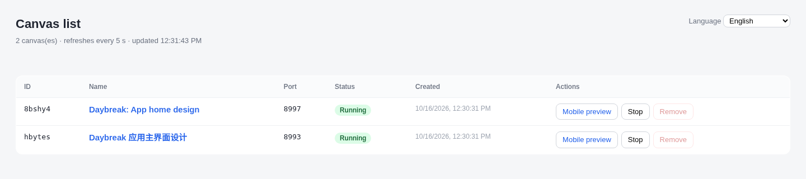
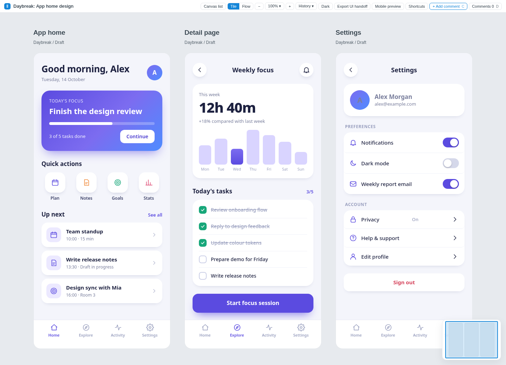
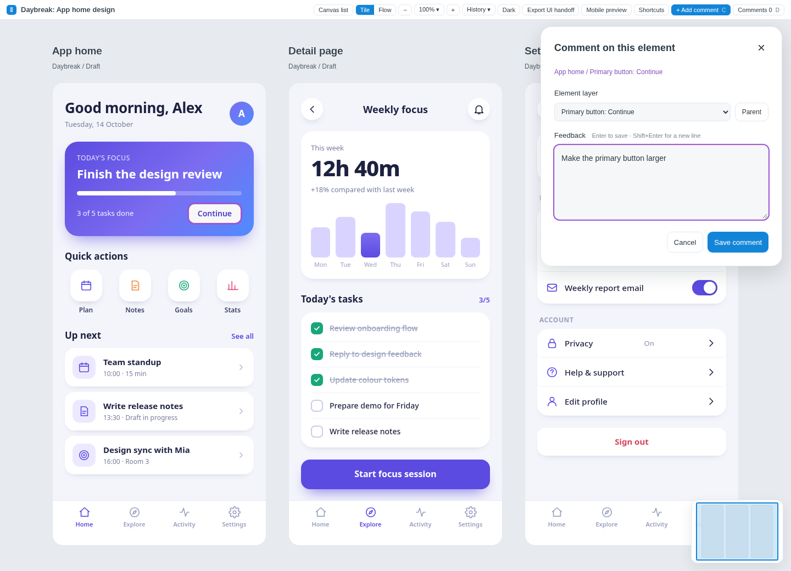
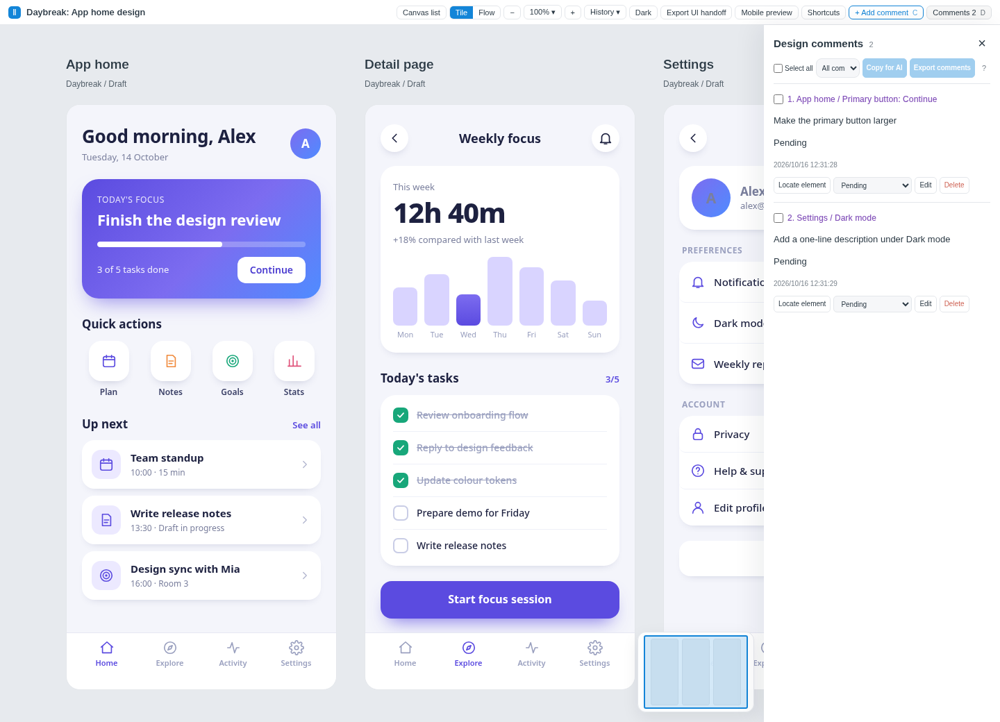
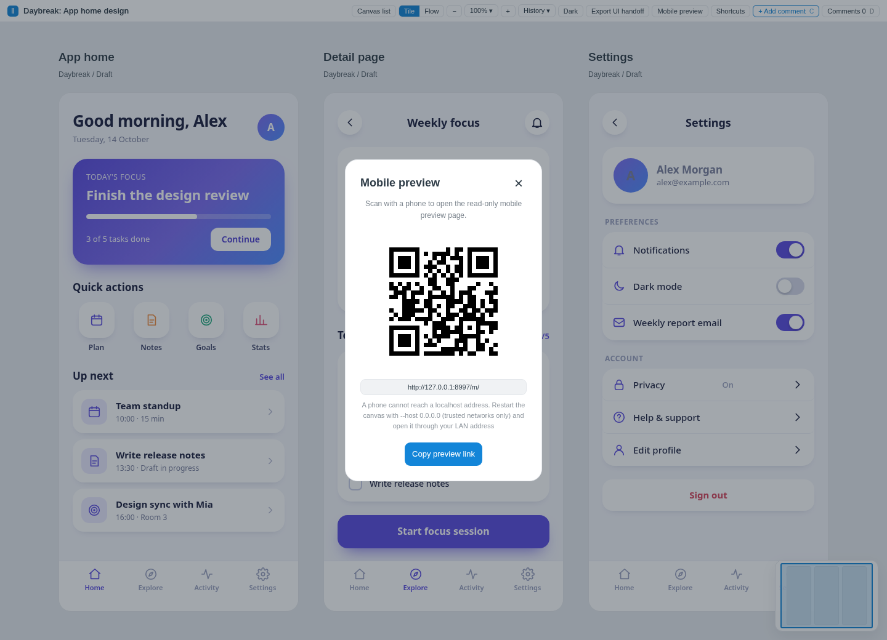

# Easy UI Canvas

Author: karlarso · Apache-2.0

English | [简体中文](README.zh-CN.md)

> **⚠️ No authentication: use it on this machine or on a network you trust only.**

> **Deploying? Hand [DEPLOY.md](DEPLOY.md) to your AI assistant.**

## 🚀 Deploy in one step

Which prompt do you need? Use the first if Easy UI Canvas is not on this machine yet. Use the second if it is already running — the list page is up and canvases exist — and you only want a new assistant (another AI tool, or a fresh session) to install the skill and use that instance.

**Not installed yet.** Give your AI assistant (Claude Code, Cursor, Codex, ...) this sentence. It will read [DEPLOY.md](DEPLOY.md), interview you about the details (bind address, autostart, ports, data location, optional export) and deploy it only after you confirm the plan. It will also ask whether to install the Easy UI Canvas skill for your AI tool (and where), and install it if you agree.

```text
Read https://raw.githubusercontent.com/karlarso/easy-ui-canvas/main/DEPLOY.md and deploy Easy UI Canvas by following it. Ask me about the bind address and autostart before you change anything.
```

The default is local-only (`127.0.0.1`); the assistant must warn you before it opens anything to your network, because the tool has no login. Chinese version: [DEPLOY.zh-CN.md](DEPLOY.zh-CN.md).

**Already running: install the skill only.** Give the new assistant this sentence. It reads [SKILL.md](SKILL.md) and the [skill-only section of DEPLOY.md](DEPLOY.md#skill-only-install), asks where and how to install the skill for that tool, installs it, finds the instance that is already running, checks that it can reach it, and tells you it is ready. It leaves the bind address, autostart, ports, data location and existing canvases as they are. Chinese version: [DEPLOY.zh-CN.md](DEPLOY.zh-CN.md#skill-only-install).

```text
Easy UI Canvas is already deployed and running. Do not redeploy it, and do not change its bind address, autostart, ports or data location, and do not stop or remove any canvas.
Read https://raw.githubusercontent.com/karlarso/easy-ui-canvas/main/SKILL.md and https://raw.githubusercontent.com/karlarso/easy-ui-canvas/main/DEPLOY.md (the section "Skill-only install on an existing deployment") and follow that section only.
Ask me where and how to install the skill for this AI tool, install it, find the running instance, check that you can reach it, then tell me you are ready.
```

## 🎨 What it is

A small local web canvas for **exploring UI designs**: put several HTML screens (frames) side by side on a zoomable, pannable board, comment on individual elements, click through flows on a phone, and let an AI coding agent read and answer the comments in the next session. It runs on your machine, needs only the Python 3 standard library, and works as an agent skill (Claude Code, Cursor, Codex) or as a plain command-line tool.

## ✨ Why use it

- 🔌 **Works with any AI coding tool.** Any assistant that can read files and run commands (Claude Code, Cursor, Codex and others) can use it, so you can switch tools or models without switching canvas.
- 🏠 **No account, no token, your data stays on your machine.** It needs only the Python standard library: no cloud service, no build step, and one sentence is enough for your AI to deploy it. You decide who can reach it; there is no login, so share it only on a network you trust (see the Security section below).
- ⚡ **Fast, precise feedback.** A comment is anchored to a specific element, so your AI knows exactly what you mean when it reads it. Once deployed, the whole loop from asking for a screen to commenting on individual elements runs smoothly.
- 🧱 **The design is real HTML/CSS, not an image.** You can reuse it directly as code, so there is no separate design-to-development step.

## 💬 Usage examples

Once Easy UI Canvas is running and your assistant has the skill (see “Deploy in one step” above), one plain sentence is enough: the skill already knows how to create a canvas or continue an existing one, write the frames, make elements commentable, link the screens and hand you the URL. Five typical situations:

### 1. Design an app component library

```text
Use Easy UI Canvas to design a component library for a
bookkeeping app: buttons, inputs, cards and list items.
```

> What happens next: the assistant gives you a canvas link. Click elements on the canvas to write comments; the assistant reads them and keeps revising.

### 2. Improve a page of your own project

Replace the placeholder with a page from your own repository (for example the pricing page).

```text
Use Easy UI Canvas to draw the current state of
<a page in my repo, e.g. the pricing page>,
then give me two improved versions next to it to compare.
```

> What happens next: the assistant gives you a canvas link. Click elements on the canvas to write comments; the assistant reads them and keeps revising.

### 3. Design a new feature

```text
Use Easy UI Canvas to design the screens for a "shared team album"
feature: create album, invite members and browse.
```

> What happens next: the assistant gives you a canvas link. Click elements on the canvas to write comments; the assistant reads them and keeps revising.

### 4. Continue an existing canvas

Name the canvas, or paste its link.

```text
Use Easy UI Canvas to take over my existing canvas
<name or link> and keep working on it. Read the frames
and the comments first, then continue from there.
```

> What happens next: the assistant finds that canvas (and asks if more than one matches), reads its frames and the comments with their status, and continues on that same canvas. If the canvas is stopped, the assistant starts it. It gives you the link.

### 5. Continue from an exported UI hand-off

Point the assistant at a ZIP from "Export UI handoff" (offline pages, screenshots, assets and `HANDOFF.md`). The assistant unpacks it and creates a new canvas from the exported frames; there is no one-step import command.

```text
Use Easy UI Canvas to open a new canvas from this
exported UI hand-off ZIP <path to the zip>
and continue the design there.
```

> What happens next: the assistant unpacks the ZIP, reads `HANDOFF.md`, and creates a new canvas from the exported frames and `project.json`. It gives you that canvas's link. The ZIP does not contain comments, so the new canvas has none.

Everything else (frame structure, element ids, tap-through links, the phone preview and how to answer comments) is handled by the skill; see [SKILL.md](SKILL.md). The phone preview needs a phone that can reach the canvas address, which needs a non-local bind (see [DEPLOY.md](DEPLOY.md)).

## 🖼️ Screenshots

Real captures from a running instance, using the bundled example project (a three-screen app design).

**Canvas list**: every canvas is its own small server; the list page starts, stops and removes them.



**Canvas, tile view**: app home, detail page and settings side by side.



**Add a comment**: turn on comment mode, click an element (highlighted) and write the feedback.



**Comments panel**: all feedback in one place, with status and "copy for AI".



**Mobile preview**: scan the QR code to open the read-only phone page.



## 🧩 Features

- 🗂️ **Multi-frame canvas**: tile view with zoom, pan, minimap and fit-to-window; frames are plain HTML/CSS fragments you or an agent write.
- 💬 **Element comments**: click any element (or the whole frame, a frame title, or a free-standing note on the board), write feedback, track it as pending / changed / needs discussion, copy it for an AI, and reply from the command line.
- 📱 **Flow view and phone preview**: mark buttons with `data-goto` to make a prototype clickable inside the canvas and at `/m/` on a phone (QR code included). Give the scrolling element of several states of one page the same `data-keep-scroll="name"` to keep the scroll position when jumping between them.
- 🕘 **Snapshots**: keep earlier revisions with their comments and look back at them read-only.
- 📋 **Many canvases, one list page**: each canvas is its own small server; a list page starts, stops and removes them.
- 📤 **UI hand-off export**: one ZIP with offline pages, screenshots, assets and a `HANDOFF.md` (needs optional tools, see below).
- 🌐 **English and Chinese UI**, switchable on the list page; also for server errors and CLI output.
- 🪶 **No build step, no CDN, no third-party Python packages.**
- 📁 **Plain files, git-friendly**: a canvas is just files in a directory (HTML, JSON, assets), so it can live in a git repository.
- 📄 **Open source**: Apache-2.0.

Comments reach beyond the screens: frame titles and subtitles can be selected out of the box, and free-standing notes (`notes` in `project.json`, one HTML fragment each) can sit anywhere on the board. Comments on a note are filed under the frame "Canvas". See [docs/project-format.md](docs/project-format.md).

## 🛠️ Manual setup (without AI-assisted deployment)

<details>
<summary>Show the manual steps</summary>

Requirements: Python 3.9 or newer, macOS or Linux (Windows through WSL).

```bash
git clone https://github.com/karlarso/easy-ui-canvas.git easy-ui-canvas
cd easy-ui-canvas
python3 scripts/canvas.py ensure-list                 # starts the list service on http://127.0.0.1:4042/
python3 scripts/canvas.py new --name "My first canvas" # creates a canvas from the example and starts it
```

Project format: [docs/project-format.md](docs/project-format.md).

</details>

## 📦 Dependencies

- **Runtime: the Python 3 standard library only.** Nothing to `pip install`.
- **"Export UI handoff" (optional)** takes full-page screenshots, so you must install Node.js, [Playwright](https://playwright.dev/) and Chromium or Google Chrome yourself (for example `npm install playwright` and `npx playwright install chromium`). They are optional external tools, are not bundled or distributed with this repository, and are never installed automatically. Set `UI_CANVAS_PLAYWRIGHT_MODULE` if Playwright is not found. Everything else works without them.
- **Tests** use only the standard library and Node.js; the browser smoke test and QR cross-check additionally use the optional packages named in their headers and skip themselves when those are missing.

## 💻 Platforms

macOS and Linux are supported. On Windows use WSL. Autostart is optional; see [DEPLOY.md](DEPLOY.md) (guided deployment for your AI assistant) and [docs/autostart.md](docs/autostart.md) (macOS LaunchAgent, Linux systemd, WSL).

## 🔒 Security

**There is no authentication.** Anyone who can reach a port can read and change your canvases and comments.

- By default every server listens on `127.0.0.1` only, and requests with a non-loopback `Host` header are refused (protection against DNS rebinding). Write endpoints accept same-origin requests only.
- To open the canvas to other devices (for example a phone on your Wi-Fi) you must ask for it: `--host 0.0.0.0`, `--host <address>`, `--host auto` (detected LAN/VPN addresses) or `UI_CANVAS_BIND`. Do this only on networks you trust. The command output states whether each URL is local-only.
- Frame HTML is written by you or your agent; never import untrusted third-party pages as frames (scripts in fragments do not run, but CSS and markup do).

## 🌐 Language

The UI follows your browser language (Chinese for `zh*`, English otherwise) until you choose one on the list page; the choice is stored on the server so every canvas, the phone preview and the CLI agree. Details: [docs/i18n.md](docs/i18n.md).

## 📁 Project layout

```text
scripts/canvas.py        CLI and servers (Python stdlib)
scripts/export_ui.py, export-ui.cjs   UI hand-off export
assets/                  front end (canvas.html/js/css, list.html, mobile.html, i18n.js, i18n.json)
examples/en, examples/zh example projects
docs/                    format, behaviour, i18n, autostart
DEPLOY.md, DEPLOY.zh-CN.md   deployment guide to hand to your AI assistant
tests/                   tests
SKILL.md                 agent instructions
```

To run the tests, see [Running the tests](CONTRIBUTING.md#running-the-tests) in [CONTRIBUTING.md](CONTRIBUTING.md).

## 📄 License

Copyright 2026 karlarso, licensed under Apache-2.0, third-party notice see NOTICE. See [LICENSE](LICENSE) and [NOTICE](NOTICE).

Third-party: the QR encoder in `assets/canvas.js` is adapted from Project Nayuki's QR Code generator (MIT License); see [NOTICE](NOTICE).
